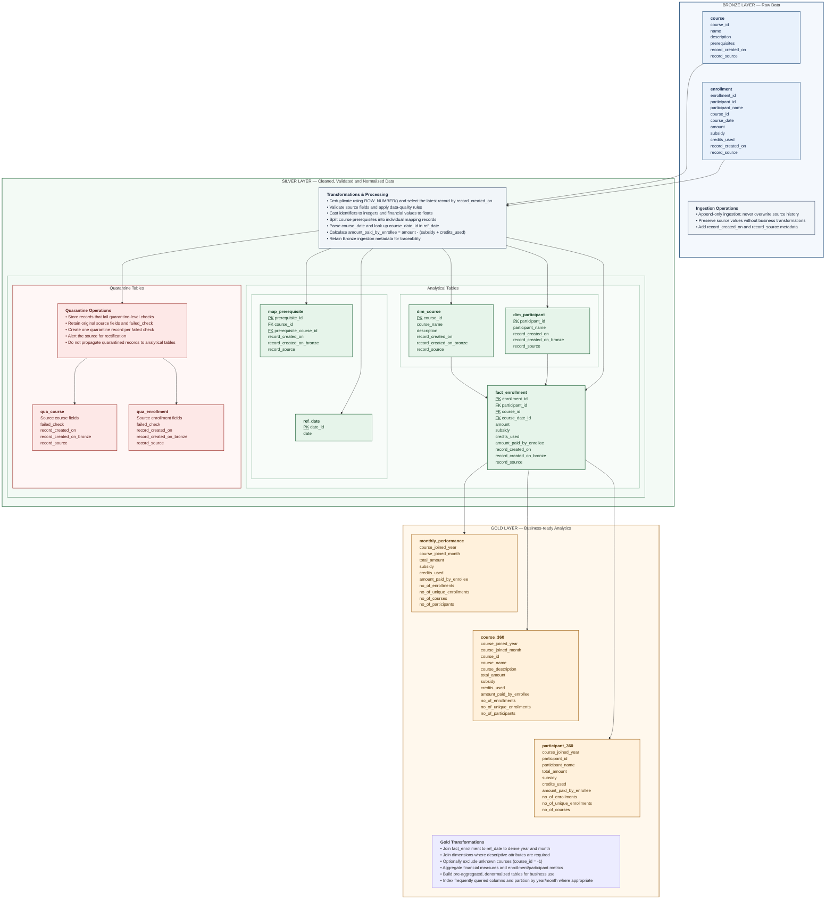
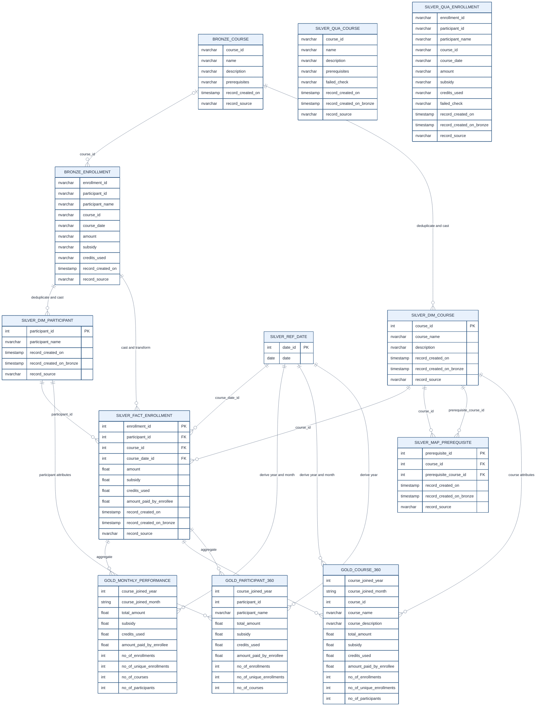

# Medallion Data Architecture

## 1. Medallion Architecture – Data Flow

## 2. Data Quality Checks

These checks are performed between the Bronze and Silver layers. Depending on the check, failed records are either quarantined or allowed to continue into Silver with an appropriate alert.

| Source table | Field | Data quality check | Action on failure |
|---|---|---|---|
| course | course_id | Must be a non-null integer | Quarantine and alert |
| course | prerequisites | Must be a valid comma-separated array of existing course IDs | Alert; continue ingestion |
| enrollment | enrollment_id | Must be a non-null integer | Quarantine and alert |
| enrollment | participant_id | Must be a non-null integer | Quarantine and alert |
| enrollment | course_id | Must be a non-null integer present in dim_course | Alert; use placeholder course_id = -1 and course_name = 'Unknown' |
| enrollment | course_date | Must be parseable into a valid date | Quarantine and alert |
| enrollment | amount | Must be parseable into a decimal value | Quarantine and alert |
| enrollment | subsidy | Must be parseable into a decimal value OR NULL | Quarantine and alert if not parseable; allow NULL |
| enrollment | credits_used | Must be parseable into a decimal value OR NULL | Quarantine and alert if not parseable; allow NULL |

### Quarantine Tables

Quarantine tables are maintained in the Silver layer.

| Table | Contents | Additional field |
|---|---|---|
| qua_course | Failed course records, retaining original source fields | failed_check: NVARCHAR |
| qua_enrollment | Failed enrollment records, retaining original source fields | failed_check: NVARCHAR |

**Quarantine processing rules:**
- Only records that fail quarantine-designated checks are stored.
- Original source values are retained.
- The `failed_check` field records the failed check and its reason.
- A single Bronze record can generate multiple quarantine records if it fails multiple checks.
- Quarantined records do not continue into Silver's analytical tables.
- Alerts should be sent to the source for rectification.
- NULL values for `subsidy` and `credits_used` are permitted and do not result in quarantine.

---

## 3. Entity Relationship Diagram (ERD)

The following ER diagram illustrates the relationships across all three layers.

### ERD Relationship Notes

| Relationship | Cardinality | Explanation |
|---|---|---|
| dim_course → fact_enrollment | 1:N | A course can have multiple enrollments |
| dim_participant → fact_enrollment | 1:N | A participant can have multiple enrollments |
| ref_date → fact_enrollment | 1:N | A date can be associated with multiple enrollments |
| dim_course (course_id) → map_prerequisite | 1:N | A course can have multiple prerequisite mappings as the course being studied |
| dim_course (prerequisite_course_id) → map_prerequisite | 1:N | A course can be a prerequisite for multiple other courses |

**Important modelling considerations:**

1. Bronze relationships represent logical source relationships. The source tables are not explicitly defined with primary and foreign key constraints.
2. The Silver fact table has a primary key on `enrollment_id`, reflecting the assumption that one enrollment ID maps to exactly one course.
3. The prerequisite mapping table has two foreign keys pointing to `dim_course`, representing the course and its prerequisite.
4. Quarantine tables are exception-storage tables. They are not part of the analytical relational model and therefore have no declared foreign key relationships.
5. Gold tables are pre-aggregated analytical outputs. Their schemas do not specify primary keys or foreign keys; the ERD therefore shows their data lineage rather than asserting physical constraints.

---

## 4. Gold Layer – Aggregation Logic

| Gold table | Grouping dimensions | Key operations |
|---|---|---|
| monthly_performance | course_joined_year, course_joined_month | SUM financial measures; COUNT DISTINCT enrollment, enrollment + participant, courses and participants |
| course_360 | course_joined_year, course_joined_month, course_id, course_name, course_description | SUM financial measures; COUNT DISTINCT enrollment, enrollment + participant and participants |
| participant_360 | course_joined_year, participant_id, participant_name | SUM financial measures; COUNT DISTINCT enrollment, enrollment + participant and courses |

### Performance Considerations

- Index frequently queried columns in Silver and Gold.
- Partition Gold tables using `course_joined_year` and `course_joined_month` where appropriate.
- Maintain the `ref_date` table by adding future dates periodically.
- Allow Gold tables to evolve according to business reporting requirements.
- Consider filtering `course_id = -1` when reporting requires only records associated with known courses.

## 5. Notes

- This document, until '4. Gold Layer – Aggregation Logic', was generated by AI using the input from the document 'Database_Design_Document.md', created by me, and some prompting. I've modified some HTML code in '1. Medallion Architecture – Data Flow' and briefly reviewed the document for any inconsistencies.
- Click this [link](https://chatgpt.com/share/6af0a786-6868-83ec-b1d7-c0038305c62d) for the conversation that I had with ChatGPT to create this document.