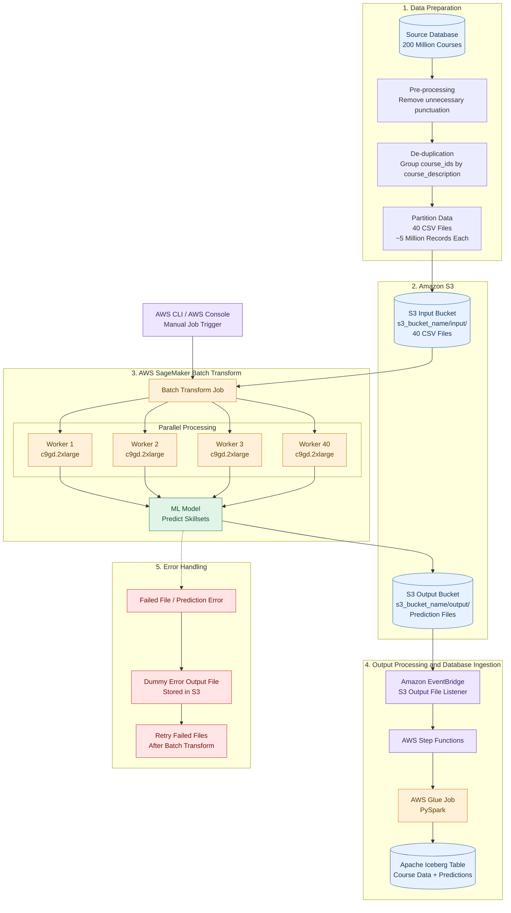
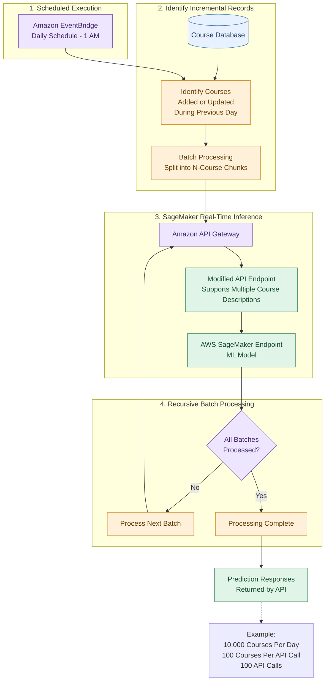

# Architecture Design

## 1. Ad-hoc Job – Initial Processing (200 Million Records)

This job runs once to process the existing 200 million course records. It uses AWS SageMaker Batch Transform to perform offline inference in parallel across multiple workers.

### Architecture Diagram

### Processing Steps

1. Extract the existing course records from the source database.
2. Pre-process course descriptions by removing unnecessary punctuation.
3. De-duplicate records based on `course_description`, retaining the associated `course_ids`.
4. Randomly partition the data into 40 CSV files, each containing approximately 5 million records.
5. Upload the CSV files to the Amazon S3 input folder.
6. Trigger an AWS SageMaker Batch Transform job using AWS CLI or the AWS Console.
7. SageMaker distributes the files across 40 workers and performs parallel inference.
8. Store the prediction output files in the Amazon S3 output folder.
9. Amazon EventBridge listens for new output files and triggers AWS Step Functions.
10. Step Functions orchestrates an AWS Glue job, which uses PySpark to ingest the output files into the Apache Iceberg table.
11. Failed files are identified and retried separately.

### SageMaker Batch Transform – Initial Configuration

| Configuration | Initial Value |
|---|---|
| Number of workers | 40 |
| Instance type | c9gd.2xlarge |
| Input files | 40 CSV files |
| SplitType | Line |
| MaxConcurrentTransforms | 5 |
| BatchStrategy | MultiRecord |
| MaxPayloadInMB | 6 MB |
| Input S3 path | s3_bucket_name/input/ |
| Output S3 path | s3_bucket_name/output/ |

These are starting parameters and should be fine-tuned through sample Batch Transform jobs to optimise performance, error rates and cost.

---

## 2. Incremental Job – Daily Processing

Once the initial 200 million records have been processed, the pipeline switches to incremental processing.

This job runs once daily at 1 AM and processes only newly added courses and courses whose descriptions have changed.

### Architecture Diagram

### Processing Steps

1. Amazon EventBridge triggers the incremental job daily at 1 AM.
2. Identify all courses that were added or had their descriptions updated during the previous day.
3. Batch the identified courses into chunks of N records.
4. Invoke the modified API endpoint, which supports multiple course descriptions in a single request.
5. The endpoint invokes the SageMaker model and returns predictions for the submitted courses.
6. Continue processing the next batch until all batches have been processed.

### Example Configuration

Assuming 10,000 courses are added or modified each day:

| Parameter | Value |
|---|---|
| Daily incremental records | 10,000 |
| Courses per API request (N) | 100 |
| Total API requests | 100 |
| Maximum API timeout | 30 seconds |
| Execution frequency | Daily at 1 AM |

The value of N must be established through performance testing to ensure that the endpoint can process the entire batch without exceeding the 30-second API timeout.

---

## 3. AWS Services and Other Tools Used

### AWS Services

| AWS Service | Purpose |
|---|---|
| **Amazon S3** | Stores the input CSV files and output prediction files for the ad-hoc Batch Transform job. |
| **AWS SageMaker Batch Transform** | Performs large-scale offline inference across the 200 million existing course records. |
| **AWS SageMaker Endpoint** | Hosts the ML model and provides predictions for multiple course descriptions per API request. Used by the incremental job. |
| **Amazon API Gateway** | Exposes the SageMaker inference API for incremental processing. |
| **Amazon EventBridge** | Listens for new output files in S3 and triggers the downstream workflow. Also schedules the incremental job daily at 1 AM. |
| **AWS Step Functions** | Orchestrates the downstream output-processing workflow. |
| **AWS Glue** | Runs the PySpark job responsible for ingesting prediction output files into the Iceberg table. |

### Other Tools and Technologies

| Tool / Technology | Purpose |
|---|---|
| **Apache Iceberg** | Table format used for storing the processed course data and predictions. |
| **PySpark** | Distributed data processing within the AWS Glue job. |
| **CSV** | Input and output file format used by the Batch Transform job. |
| **AWS CLI** | Used to manually trigger the initial Batch Transform job. |
| **AWS Management Console** | Alternative interface for triggering the initial Batch Transform job. |
| **Python** | Used for the application-side processing and API invocation logic. |

### Infrastructure and Processing Components

| Component | Configuration / Purpose |
|---|---|
| **c9gd.2xlarge** | Compute-optimised SageMaker Batch Transform worker instance. |
| **40 Workers** | Provides parallel processing across the 40 input CSV files. |
| **MaxConcurrentTransforms** | Controls the number of concurrent model invocations per worker. Initial value: 5. |
| **MultiRecord** | Allows multiple records to be grouped into a single inference request. |
| **SplitType: Line** | Allows SageMaker to split CSV files into smaller mini-batches. |
| **MaxPayloadInMB** | Controls the maximum mini-batch payload size. Initial value: 6 MB. |

---

## 4. Important Design Considerations

1. **Multi-record inference support:** The Data Scientist must modify the model endpoint to accept multiple course descriptions in a single inference request.

2. **Batch Transform tuning:** Worker instance type, MaxConcurrentTransforms and MaxPayloadInMB should be tested using sample datasets before running the full workload.

3. **Error handling:** The model endpoint should implement a try-catch mechanism to produce error output files in S3 when processing fails, allowing failed files to be identified and retried.

4. **Partition sizing:** The initial design uses 40 CSV files of approximately 5 million records each. File sizes and partition counts should be reviewed to optimise processing and reduce the cost of retries.

5. **Incremental API timeout:** The number of courses per API request must be selected based on model throughput and the 30-second API Gateway timeout.

6. **Database destination:** The ad-hoc ingestion workflow assumes the database layer is built on Apache Iceberg. If the database is external or on-premises, the output files may need further subdivision before ingestion.

7. **Incremental persistence:** The exact destination and write mechanism for incremental prediction responses should be defined as part of the implementation design.

## 5. Notes

- This document, except '5. Notes', was generated by AI using the input from the document 'Solution_Design_Document.md', created by me, and some prompting. I've briefly reviewed the document for any inconsistencies.
- Click this [link](https://chatgpt.com/share/6af18052-67e8-83ec-b2e0-cbf7a42d7521) for the conversation that I had with ChatGPT to create this document.