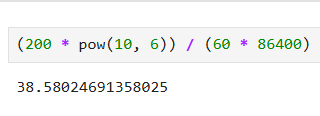

The problem:::
Assuming that you are working with a courses table that contains 200 million records. Each course has a description, and your Data Scientist has built a machine learning model that reads a course description that predicts the skillsets required for that course. This model has been deployed as an AWS SageMaker endpoint, meaning your pipeline calls the model via an API to get predictions.

After running the pipeline, you realise it will take 2 months to process all 200 million records — which is far too long. Your task is to identify the bottleneck and explain how you would optimise this pipeline. Consider both how the SageMaker endpoint is being served, and how the script calling the endpoint is written.

Considerations:::
-- Let's calculate how many rows the current pipeline is processing every second.
    
    ~ 39 rows / sec
    This needs to be improved
-- The problem states that the ML model reads a course description and predicts the 
    skillsets required. If the API only accepts one course per call, then this could
    be a limitation. We can consider modifying the endpoint to predict multiple courses in 
    a single API call
        -- We will also have to keep in mind the 30s timeout on AWS API Gateway. Even if the
            model can predict a 1000 courses per API call, if it takes longer than 30s, then
            we will be hitting a lot of timeouts and wasting resources. An exercise can be
            performed to check the rate at which the model can generate predictions per 
            second. From here, we can gauge the maximum no of predictions it can make in 
            a single API call (with a 30 second timeout)
        -- We will also have to account for the the additional overhead to make the API 
            call, wait for the response and then ingest it into the database
-- We would need to check if the AWS Sagemaker endpoint is being served through the AWS API 
    Gateway via an AWS Lambda or if the Gateway is calling the endpoint directly. The 
    direct method could cut the Lambda invocation times out of the equation, thereby 
    reducing latency
-- When it comes to the data, there could be a case where a course is duplicated across
    different course_ids with the same course_description because users have copied the 
    it from the original course. In this case, finding unique course_descriptions in the 
    dataset can help us figure out if the duplicates problem is one that needs to be taken
    into account
-- If our pipeline is reading from a traditional database like an SQL Server, reading 200 
    million records and processing them could take a really long time. If we can export
    the data into AWS S3 (as parquet files or an Iceberg table), then the processing will 
    be much faster
-- Since the volume is so huge, we would be better off processing it in batches. I would
    partition the data in S3 based on the starting character of the course_description.
    This would give us ~26 different partitions of 7.7 million rows (assuming that the
    course_descriptions are pre-processed to remove unnecessary punctuations, like bullet 
    points at the start of the text). If we were to go this route, we should ditch the 
    API Gateway API and do offline processing instead. Once the entire 200 million records
    are processed, then we can utilize the API for incremental processing (new courses and
    courses with updated descriptions)
-- We will also need to check if there is any kind of parallelism involved with the current
    pipeline. If not, then we should consider implementing it. As the predictions for 
    individual course_descriptions are independent from one another, parallelism can vastly 
    improve the pipeline performance
-- I was debating between using AWS Sagemaker Asynchronous Inference and Batch Transform.
    I eventually decided on Batch Transform for this use case as our dataset is huge and
    we don't really need real-time predictions. We are okay with the low latency in this
    case. However, if we had a use case to process all the courses in near real-time (max of 15 mins), then we can go with the former option

Design:::
-- We will run this pipeline as an ad-hoc job once, and then as an incremental job
    subsequently
-- A prerequisite is that we ask the Data Scientist to design the endpoint so that it can
    support predictions for multiple course_descriptions at once. Without this capability,
    we cannot truly batch up our predictions as each course_description will have to have
    a separate inference call to the model
-- First, we pre-process the data (remove unnecessary punctuation)
-- De-duplicate the data on course_descriptions [New structure - ["course_id-1", 
    "course_id-2"], "course_description"]
-- Split the files into partitions. As stated above, we can partition them based on the 
    starting alphabet of course_description. This will give us 26 partitions with ~7.7 
    million records each. On second thought, this is probably not the best idea as there could be a lot of course_descriptions that start with 'A' and very few that start with 'Z'. We also need to efficiently process the output, and thus, there cannot be too many rows in one single csv file. So, let's just split the data into 40 partitions randomly
    -- We now have 40 different csv with ~5 million records each
    -- This will need to be reviewed and tweaked based on the following considerations:
        -- How many output records should a file have for efficient ingestion back into 
            our Database?
        -- Is 40 partitions too much for the Batch Trasnform job to handle?
        -- Are we getting enough concurrency out of the job on these partitions?
    -- We upload these files to an S3 bucket (say, s3_bucket_name/input/courses_1.csv,      
        courses_2.csv etc.,.)
-- Next, we create the Transform job
    -- There are a few important configuration settings that need to be set when creating
        then job
        -- Job Level
            -- No of workers (instances)
                -- This is generally be the no of csv files we have, 40
            -- Worker type
                -- We need to use a compute-optimized machine as we are dealing
                    with a parallelize-heavy workload
                -- We can go with c9gd.2xlarge. It has 8 cores and 8 virtual CPUs          
            -- The S3 bucket input path
                -- s3_bucket_name/input/
            -- The s3 bucket output path
                -- s3_bucket_name/output/
                -- The ouptut files will be stored here at the end of the job run.
                    One input file will generate one output file
            -- SplitType
                -- Set to Line so that AWS can split a single csv file into multiple
                    mini-batches
        -- Worker Level
            -- MaxConcurrentTransforms
                -- The no of concurrent invocations each worker makes to the model
                -- We can use 5 concurrent invocations as a start as the c9gd.2xlarge 
                    machine has 8 cores
            -- BatchStrategy
                -- Set to 'MultiRecord' to batch together multiple records in a 
                    mini-batch. AWS will fit as many as it can while respecting
                    MaxPayloadInMB
            -- MaxPayloadInMB
                -- Max size of the mini-batch created by AWS
                -- MaxConcurrentTransforms * MaxPayloadInMB cannot be greater than 100 MB
                -- We can set this to 6 MB (the default) so that the limit is still met
                    and we don't have the problem of each mini-batch having too many
                    records
    -- These are all starting parameters and will need to be tweaked based on the   
        acceptable timeframes to complete the job and whether the infrastructure can
        process >95% of the records successfully without any timeout and other errors
    -- The Worker type, MaxConcurrentTransforms and MaxPayloadInMB will need to be  
        modified to test for performance, error rate and cost-effectiveness by running 
        sample Batch Transform jobs (with maybe 5% of the data) with variations of these parameters. Once the performance, error rates and the cost-effectiveness are in the 
        acceptable ranges, then that set of varibales can be used for the actual job
-- This job needs to be triggered once. This can be done from an AWS CLI or on the UI   
    itself. Hence, a separate trigger from AWS Lambda or a Glue job is not needed
-- We will need to create a Glue job along with an AWS Step function + AWS Event  
    Bridge listener on the s3_bucket_name/output/ folder to look for output files. Whenever 
    they are dropped in the folder, our Glue job using PySpark ingests the files into an 
    Iceberg table (assuming that our DB layer is built on Iceberg). If our database is 
    stored externally (on-premise for example), then we may have to further sub-divide the 
    each file and export them to that server
-- Based on the above parameters, ChatGPT estimates that the job will take around 14 hours 
    to complete execution [Conversation Link](https://chatgpt.com/share/6af1746a-40c8-83ec-819a-da00bcabbd72)
-- We also need to be wary of errors during job execution. As the Batch Transform job 
    does not produce an output if it encounters an error during a file's execution, the
    Data Scientist may need to include a try catch mechanism in the endpoint definition
    to create a dummy output file in s3 with the error messsage included. At the end of the 
    Batch Transform job's execution, we can retry with just the errored-out files. We can
    also consider smaller file sizes (2 million records, 100 files) in the main job to 
    reduce the overhead to re-process errored-out files as even one record may derail the
    output of already-processed 100s of thousands of records
-- For the incremental job, we run it on a schedule once a day (let's say at 1 AM). This 
    job collates all the course_descriptions that have changed or were added during the 
    previous day, batches them up into N-course chunks (N being the maximum that the API
    endpoint can handle without timing out after 30 seconds) and calls the now-modified API 
    endpoint recursively until all the batches are processed. If we expect 10000 courses to
    be added or modified each day, and N resolves to 100 after performance testing, then
    the pipeline now makes 100 calls (30s max each). This will take about an hour, which is
    acceptable